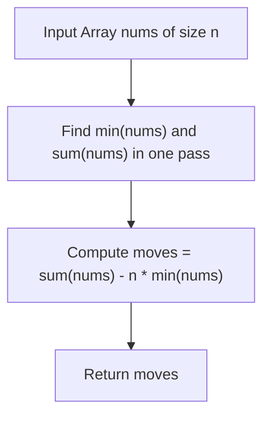

# 453. Minimum Moves to Equal Array Elements

## Problem Statement

Given an integer array `nums` of size `n`, return *the minimum number of moves required to make all array elements equal*.

In one move, you can increment `n - 1` elements of the array by `1`.

### Example 1:

```
Input: nums = [1,2,3]
Output: 3
Explanation: Only three moves are needed (remember each move increments two elements):
[1,2,3]  =>  [2,3,3]  =>  [3,4,3]  =>  [4,4,4]
```

### Example 2:

```
Input: nums = [1,1,1]
Output: 0
```

### Constraints:

- $n == \text{nums.length}$
- $1 \le \text{nums.length} \le 10^5$
- $-10^9 \le \text{nums}[i] \le 10^9$
- The answer will fit in a **32-bit** integer.

---

## Approach

### 1. Mathematical Equivalence: Relative Invariant
Directly simulating the increments of $n - 1$ elements is prohibitively slow because $n \le 10^5$ and numbers can be up to $10^9$.

Instead, observe the relative difference between numbers:
- Adding $1$ to $n - 1$ elements increases the relative gap between those $n - 1$ elements and the single element left unchanged by $+1$.
- This is mathematically equivalent to **decrementing the single unchanged element by $1$** relative to all other elements.
- Making all elements equal by incrementing $n - 1$ elements at each step is isomorphic to making all elements equal to the array's minimum element $\min(\text{nums})$ by decrementing one element at each step.

### 2. Derivation of the Formula
Let $\min(\text{nums})$ be the minimum value in `nums`.
To reduce every element $\text{nums}[i]$ down to $\min(\text{nums})$, the number of decrements needed for element $i$ is:
$$\text{moves}_i = \text{nums}[i] - \min(\text{nums})$$

Summing over all $n$ elements gives the total moves:
$$\text{Total Moves} = \sum_{i=0}^{n-1} (\text{nums}[i] - \min(\text{nums})) = \sum_{i=0}^{n-1} \text{nums}[i] - n \cdot \min(\text{nums})$$



---

## Code Implementation

### C++

```cpp
#include <vector>
#include <numeric>
#include <algorithm>

using namespace std;

class Solution {
public:
    int minMoves(vector<int>& nums) {
        long long sum = 0;
        int min_val = nums[0];

        for (int x : nums) {
            sum += x;
            min_val = min(min_val, x);
        }

        return static_cast<int>(sum - static_cast<long long>(min_val) * nums.size());
    }
};
```

### Python3

```python
class Solution:
    def minMoves(self, nums: list[int]) -> int:
        # Incrementing n - 1 elements by 1 == Decrementing 1 element by 1
        return sum(nums) - len(nums) * min(nums)
```

---

## Complexity Analysis

- **Time Complexity**: $O(n)$ — A single linear scan over the array to compute the total sum and find the minimum element.
- **Space Complexity**: $O(1)$ — Only a constant number of scalar accumulator variables are used.

---
