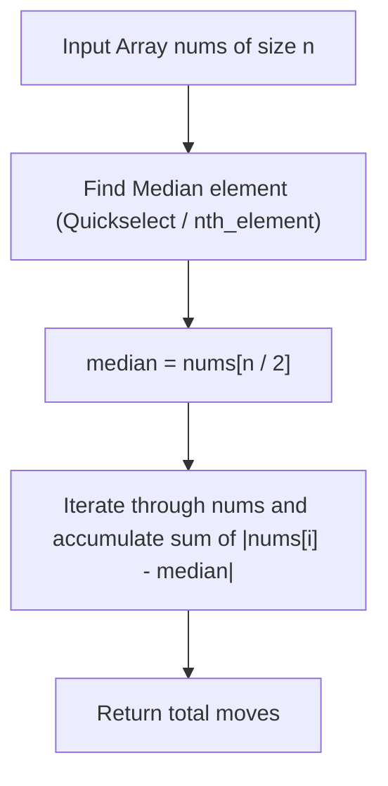

# 462. Minimum Moves to Equal Array Elements II

## Problem Statement

Given an integer array `nums` of size `n`, return *the minimum number of moves required to make all array elements equal*.

In one move, you can increment or decrement an element of the array by `1`.

Test cases are designed so that the answer will fit in a **32-bit** integer.

### Example 1:

```
Input: nums = [1,2,3]
Output: 2
Explanation:
Only two moves are needed (remember each move increments or decrements one element):
[1,2,3]  =>  [2,2,3]  =>  [2,2,2]
```

### Example 2:

```
Input: nums = [1,10,2,9]
Output: 16
Explanation:
Sorting the array gives [1, 2, 9, 10].
Choosing the median 2 (or 9) as target:
|1 - 2| + |2 - 2| + |9 - 2| + |10 - 2| = 1 + 0 + 7 + 8 = 16.
```

### Constraints:

- $n == \text{nums.length}$
- $1 \le \text{nums.length} \le 10^5$
- $-10^9 \le \text{nums}[i] \le 10^9$

---

## Approach

### 1. Median Minimization Property ($L_1$ Norm)
We seek an integer target value $x$ that minimizes the total moves:
$$f(x) = \sum_{i=0}^{n-1} |nums[i] - x|$$

Consider pairing the sorted elements from outside in: $(nums[0], nums[n - 1])$, $(nums[1], nums[n - 2])$, $\dots$
For any pair $(a, b)$ with $a \le b$, the distance to any choice $x$ satisfies:
$$|a - x| + |b - x| \ge b - a$$
Equality holds if and only if $a \le x \le b$.

To simultaneously minimize the sum of distances for **all** symmetric pairs, $x$ must lie within the intersection of all intervals $[nums[i], nums[n - 1 - i]]$. This intersection collapses to the **median** of the array:
- If $n$ is odd, $x = nums[n / 2]$ is the unique optimal choice.
- If $n$ is even, any integer in $[nums[n / 2 - 1], nums[n / 2]]$ is optimal. Choosing $nums[n / 2]$ always works.

### 2. Algorithmic Implementations
- **Sorting Approach**: Sort `nums` in $O(n \log n)$ time, pick `median = nums[n / 2]`, and compute $\sum |nums[i] - \text{median}|$.
- **Quickselect Approach (`std::nth_element`)**: Find the median in $O(n)$ average time without fully sorting the array, then compute total moves in another linear pass.



---

## Code Implementation

### C++

```cpp
#include <vector>
#include <cmath>
#include <algorithm>

using namespace std;

class Solution {
public:
    int minMoves2(vector<int>& nums) {
        int n = nums.size();
        // Use nth_element for O(n) average-time median selection
        auto mid = nums.begin() + n / 2;
        nth_element(nums.begin(), mid, nums.end());
        int median = *mid;

        long long moves = 0;
        for (int x : nums) {
            moves += std::abs(static_cast<long long>(x) - median);
        }

        return static_cast<int>(moves);
    }
};
```

### Python3

```python
class Solution:
    def minMoves2(self, nums: list[int]) -> int:
        nums.sort()
        median = nums[len(nums) // 2]
        return sum(abs(x - median) for x in nums)
```

---

## Complexity Analysis

- **Time Complexity**:
  - **Quickselect (`std::nth_element`)**: $O(n)$ average time ($O(n^2)$ worst case) to locate the median, plus $O(n)$ to sum deviations.
  - **Sorting**: $O(n \log n)$ to sort the array, plus $O(n)$ to compute the answer.
- **Space Complexity**: $O(1)$ auxiliary memory (in-place partitioning or $O(\log n)$ recursion stack for sorting).

---
