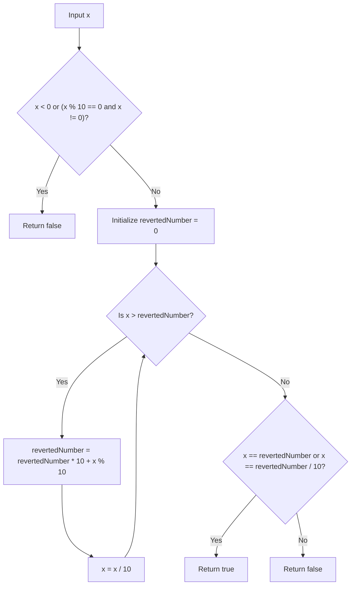

# 9. Palindrome Number

## Problem Statement

Given an integer `x`, return `true` if `x` is a **palindrome**, and `false` otherwise.

### Example 1:
```
Input: x = 121
Output: true
Explanation: 121 reads as 121 from left to right and from right to left.
```

### Example 2:
```
Input: x = -121
Output: false
Explanation: From left to right, it reads -121. From right to left, it becomes 121-. Therefore it is not a palindrome.
```

### Example 3:
```
Input: x = 10
Output: false
Explanation: Reads 01 from right to left. Therefore it is not a palindrome.
```

### Constraints:
- `-2^31 <= x <= 2^31 - 1`

**Follow up:** Could you solve it without converting the integer to a string?

---

## Approach

1. **Edge Cases:**
   - Any negative number cannot be a palindrome due to the leading negative sign (e.g., `-121` reversed is `121-`).
   - Any positive number ending in `0` cannot be a palindrome unless the number itself is `0` (e.g., `10` would require a leading zero).

2. **Reversing Half of the Number (Avoiding Overflow):**
   - Reversing the entire 32-bit integer could cause arithmetic overflow (e.g., exceeding $2^{31} - 1$).
   - We only need to reverse the **second half** of the number and compare it with the first half.
   - We extract the last digit of `x` using `x % 10` and append it to `revertedNumber` via `revertedNumber * 10 + x % 10`, while dividing `x` by 10.
   - We stop when `x <= revertedNumber`, which indicates we have processed at least half of the digits.

3. **Comparison:**
   - If the number of digits is even: `x == revertedNumber`.
   - If the number of digits is odd: the middle digit does not affect palindrome status, so we check `x == revertedNumber / 10`.



---

## Code Implementation

```cpp
class Solution {
public:
    bool isPalindrome(int x) {
        // Negative numbers are not palindromes.
        // Also, numbers ending in 0 (except 0 itself) cannot be palindromes.
        if (x < 0 || (x % 10 == 0 && x != 0)) {
            return false;
        }
        
        int revertedNumber = 0;
        while (x > revertedNumber) {
            revertedNumber = revertedNumber * 10 + x % 10;
            x /= 10;
        }
        
        // For even-length numbers: x == revertedNumber
        // For odd-length numbers: x == revertedNumber / 10 (discards middle digit)
        return x == revertedNumber || x == revertedNumber / 10;
    }
};
```

---

## Complexity Analysis

- **Time Complexity**: $O(\log_{10}(n))$ — In each iteration, we divide the input by 10. We only process half of the digits, which takes approximately $\frac{1}{2} \log_{10}(n)$ iterations.

- **Space Complexity**: $O(1)$ — Only a single integer variable (`revertedNumber`) is used for auxiliary storage.

---