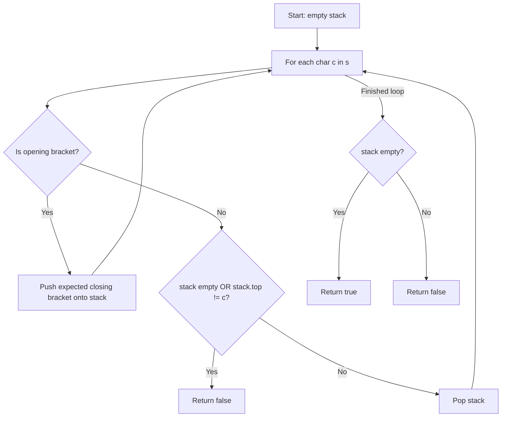

# 20. Valid Parentheses

## Problem Statement

Given a string `s` containing just the characters `'('`, `')'`, `'{'`, `'}'`, `'['` and `']'`, determine if the input string is valid.

An input string is valid if:
1. Open brackets must be closed by the same type of brackets.
2. Open brackets must be closed in the correct order.
3. Every close bracket has a corresponding open bracket of the same type.

### Example 1:
```
Input: s = "()"
Output: true
```

### Example 2:
```
Input: s = "()[]{}"
Output: true
```

### Example 3:
```
Input: s = "(]"
Output: false
```

### Example 4:
```
Input: s = "([])"
Output: true
```

---

## Approach

This problem is solved using a **Stack (LIFO)** data structure:

1. Maintain a `std::stack<char>`.
2. Iterate through each character `c` of string `s`:
   - If `c` is an opening bracket `'('`, push the expected closing bracket `')'` onto the stack.
   - If `c` is `'{'`, push `'}'`.
   - If `c` is `'['`, push `']'`.
   - If `c` is a closing bracket:
     - Check if the stack is empty (meaning there was no opening bracket) or if the top of the stack does not match `c`. If so, return `false`.
     - Otherwise, pop the matching bracket from the stack.
3. At the end, the string is valid if and only if the stack is empty (all opened brackets were closed).



---

## Code Implementation

```cpp
#include <string>
#include <stack>

class Solution {
public:
    bool isValid(std::string s) {
        std::stack<char> st;
        
        for (char c : s) {
            if (c == '(') {
                st.push(')');
            } else if (c == '{') {
                st.push('}');
            } else if (c == '[') {
                st.push(']');
            } else {
                if (st.empty() || st.top() != c) {
                    return false;
                }
                st.pop();
            }
        }
        
        return st.empty();
    }
};
```

---

## Complexity Analysis

- **Time Complexity**: $O(n)$ — We process each of the $n$ characters in the string once. Stack push and pop operations are $O(1)$.

- **Space Complexity**: $O(n)$ — In the worst-case scenario (e.g., `"(((((("`), the stack holds up to $n$ characters.

---
