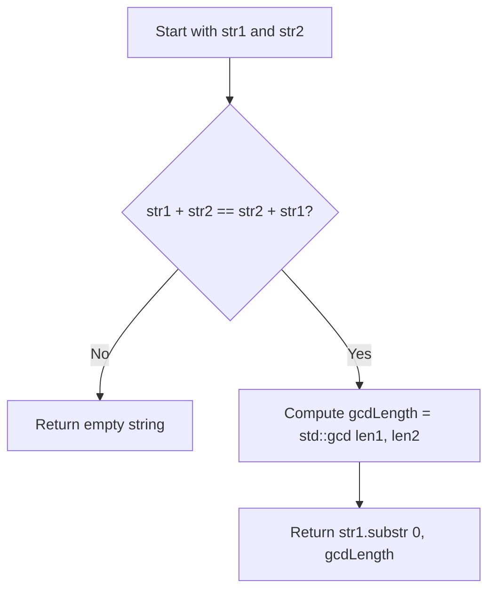

# 1071. Greatest Common Divisor of Strings

## Problem Statement

For two strings `s` and `t`, we say "`t` divides `s`" if and only if `s = t + t + t + ... + t` (i.e., `t` is concatenated with itself one or more times).

Given two strings `str1` and `str2`, return the largest string `x` such that `x` divides both `str1` and `str2`.

### Example 1:
```
Input: str1 = "ABCABC", str2 = "ABC"
Output: "ABC"
```

### Example 2:
```
Input: str1 = "ABABAB", str2 = "ABAB"
Output: "AB"
```

### Example 3:
```
Input: str1 = "LEET", str2 = "CODE"
Output: ""
```

### Constraints:
- `1 <= str1.length, str2.length <= 1000`
- `str1` and `str2` consist of English uppercase letters.

---

## Approach

We can use the **Euclidean Algorithm on String Lengths**:

1. A common divisor string can only exist if `str1 + str2 == str2 + str1`. If their concatenations in reverse order do not match, no common pattern can generate both strings, so return `""`.
2. When the condition holds, the greatest common divisor string must have a length equal to $\gcd(\text{len1}, \text{len2})$.
3. Use `std::gcd` to find the greatest common divisor of lengths of `str1` and `str2`.
4. Return the substring of `str1` from index `0` with length $\gcd(\text{len1}, \text{len2})$.



---

## Code Implementation

```cpp
#include <string>
#include <numeric>

class Solution {
public:
    std::string gcdOfStrings(std::string str1, std::string str2) {
        if (str1 + str2 != str2 + str1) {
            return "";
        }
        
        int gcdLength = std::gcd(str1.length(), str2.length());
        return str1.substr(0, gcdLength);
    }
};
```

---

## Complexity Analysis

- **Time Complexity**: $O(m + n)$ — String concatenation and equality comparison take $O(m + n)$ time where $m$ and $n$ are the lengths of `str1` and `str2`. Computing $\gcd$ of the lengths takes $O(\log(\min(m, n)))$ time.

- **Space Complexity**: $O(m + n)$ — Required for temporary string concatenation during comparison.

---
