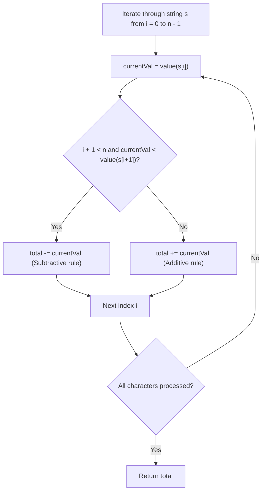

# 13. Roman to Integer

## Problem Statement

Roman numerals are represented by seven different symbols: `I`, `V`, `X`, `L`, `C`, `D` and `M`.

| Symbol | Value |
|:---:|:---:|
| I | 1 |
| V | 5 |
| X | 10 |
| L | 50 |
| C | 100 |
| D | 500 |
| M | 1000 |

For example, `2` is written as `II` in Roman numeral, just two ones added together. `12` is written as `XII`, which is simply `X + II`. The number `27` is written as `XXVII`, which is `XX + V + II`.

Roman numerals are usually written largest to smallest from left to right. However, the numeral for four is not `IIII`. Instead, the number four is written as `IV`. Because the one is before the five we subtract it making four. The same principle applies to the number nine, which is written as `IX`. There are six instances where subtraction is used:
- `I` can be placed before `V` (5) and `X` (10) to make 4 and 9.
- `X` can be placed before `L` (50) and `C` (100) to make 40 and 90.
- `C` can be placed before `D` (500) and `M` (1000) to make 400 and 900.

Given a roman numeral, convert it to an integer.

### Example 1:
```
Input: s = "III"
Output: 3
Explanation: III = 3.
```

### Example 2:
```
Input: s = "LVIII"
Output: 58
Explanation: L = 50, V= 5, III = 3.
```

### Example 3:
```
Input: s = "MCMXCIV"
Output: 1994
Explanation: M = 1000, CM = 900, XC = 90 and IV = 4.
```

### Constraints:
- `1 <= s.length <= 15`
- `s` contains only the characters `('I', 'V', 'X', 'L', 'C', 'D', 'M')`.
- It is guaranteed that `s` is a valid roman numeral in the range `[1, 3999]`.

---

## Approach

1. **Observation on Subtractive vs. Additive Rules:**
   - In standard additive Roman numerals, characters appear in non-increasing order from left to right (e.g., `VI` = $5 + 1 = 6$).
   - When a smaller value symbol strictly precedes a larger value symbol, it represents a subtraction (e.g., `IV` = $5 - 1 = 4$, `IX` = $10 - 1 = 9$).

2. **Single Pass Left-to-Right Algorithm:**
   - Iterate through each character `s[i]` from `i = 0` to `n - 1`.
   - Compare the integer value of `s[i]` with `s[i + 1]`:
     - If `i + 1 < n` and $\text{value}(s[i]) < \text{value}(s[i + 1])$, subtract $\text{value}(s[i])$ from our running total.
     - Otherwise, add $\text{value}(s[i])$ to our running total.
   - A `switch` lookup function maps each Roman character to its respective integer value in $O(1)$ time without extra heap allocations.



---

## Code Implementation

```cpp
#include <string>

class Solution {
public:
    int romanToInt(std::string s) {
        auto getValue = [](char c) -> int {
            switch (c) {
                case 'I': return 1;
                case 'V': return 5;
                case 'X': return 10;
                case 'L': return 50;
                case 'C': return 100;
                case 'D': return 500;
                case 'M': return 1000;
                default: return 0;
            }
        };
        
        int total = 0;
        int n = s.length();
        
        for (int i = 0; i < n; ++i) {
            int currentVal = getValue(s[i]);
            if (i + 1 < n && currentVal < getValue(s[i + 1])) {
                total -= currentVal;
            } else {
                total += currentVal;
            }
        }
        
        return total;
    }
};
```

---

## Complexity Analysis

- **Time Complexity**: $O(n)$ — We iterate through the string of length $n$ once. Since $n \le 15$, this executes in constant time $O(1)$.

- **Space Complexity**: $O(1)$ — Only constant auxiliary variables (`total`, `n`, `currentVal`) are used.

---