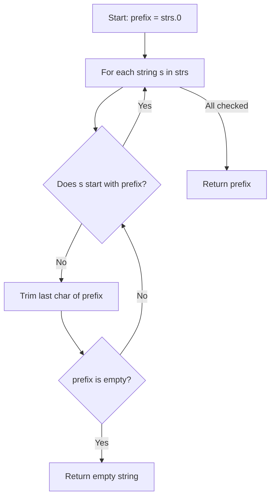

# 14. Longest Common Prefix

## Problem Statement

Write a function to find the longest common prefix string amongst an array of strings.

If there is no common prefix, return an empty string `""`.

### Example 1:
```
Input: strs = ["flower","flow","flight"]
Output: "fl"
```

### Example 2:
```
Input: strs = ["dog","racecar","car"]
Output: ""
Explanation: There is no common prefix among the input strings.
```

---

## Approach

We can use the **Horizontal Scanning** method:

1. Assume the first string `strs[0]` is the common prefix.
2. Iterate through each subsequent string in `strs`:
   - Check if the current string starts with `prefix` using `strs[i].find(prefix) == 0`.
   - If not, trim one character off the end of `prefix` using `prefix.substr(0, prefix.size() - 1)`.
   - Repeat until either it matches the start of `strs[i]` or `prefix` becomes empty.
3. If `prefix` becomes empty at any time, return `""` immediately.
4. After examining all strings, return the remaining `prefix`.



---

## Code Implementation

```cpp
#include <string>
#include <vector>

class Solution {
public:
    std::string longestCommonPrefix(std::vector<std::string>& strs) {
        if (strs.empty()) return "";
        
        std::string prefix = strs[0];
        
        for (int i = 1; i < strs.size(); ++i) {
            while (strs[i].find(prefix) != 0) {
                prefix = prefix.substr(0, prefix.size() - 1);
                if (prefix.empty()) return "";
            }
        }
        
        return prefix;
    }
};
```

---

## Complexity Analysis

- **Time Complexity**: $O(S)$ — where $S$ is the sum of all characters in all strings in the array. In the worst case, all strings are compared character by character.

- **Space Complexity**: $O(1)$ — Only a prefix string reference is modified; constant auxiliary space.

---
