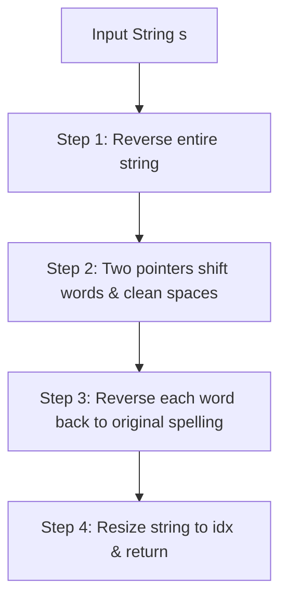

# 151. Reverse Words in a String

## Problem Statement

Given an input string `s`, reverse the order of the **words**.

A **word** is defined as a sequence of non-space characters. The words in `s` will be separated by at least one space.

Return *a string of the words in reverse order concatenated by a single space*.

**Note** that `s` may contain leading or trailing spaces or multiple spaces between two words. The returned string should only have a single space separating the words. Do not include any extra spaces.

### Example 1:
```
Input: s = "the sky is blue"
Output: "blue is sky the"
```

### Example 2:
```
Input: s = "  hello world  "
Output: "world hello"
Explanation: Your reversed string should not contain leading or trailing spaces.
```

### Example 3:
```
Input: s = "a good   example"
Output: "example good a"
Explanation: You need to reduce multiple spaces between two words to a single space in the reversed string.
```

### Constraints:
- `1 <= s.length <= 10^4`
- `s` contains English letters (upper-case and lower-case), digits, and spaces `' '`.
- There is at least one word in `s`.

**Follow-up:** If the string data type is mutable in your language, can you solve it **in-place** with $O(1)$ extra space?

---

## Approach

Since strings in C++ are mutable, we can achieve an optimal in-place solution with **$O(1)$ extra space**:

1. **Reverse Entire String:** Reversing the entire string places the words in the desired reversed order from right to left, though individual characters within each word will also be reversed.
2. **Two Pointers In-Place Shift & Word Reversal:**
   - Maintain a write pointer `idx = 0`.
   - Iterate through the string with a read pointer `start`.
   - Skip leading or multiple spaces.
   - When a word starts, if `idx > 0`, insert a single separating space `' '`.
   - Find the boundary of the current word `[start, end)`.
   - Reverse the characters of the individual word back to their original order.
   - Shift the word characters into position at `idx`.
3. **Resize:** Truncate `s` to length `idx` to remove discarded spaces.



---

## Code Implementation

```cpp
#include <string>
#include <algorithm>

class Solution {
public:
    std::string reverseWords(std::string s) {
        // Step 1: Reverse the entire string
        std::reverse(s.begin(), s.end());
        
        int n = s.size();
        int idx = 0;
        
        for (int start = 0; start < n; ++start) {
            if (s[start] != ' ') {
                // Insert a single space between words
                if (idx != 0) {
                    s[idx++] = ' ';
                }
                
                int end = start;
                while (end < n && s[end] != ' ') {
                    end++;
                }
                
                // Step 2: Reverse individual word back to normal order
                std::reverse(s.begin() + start, s.begin() + end);
                
                // Step 3: Shift the word in-place to idx
                while (start < end) {
                    s[idx++] = s[start++];
                }
            }
        }
        
        // Step 4: Truncate extra characters
        s.resize(idx);
        return s;
    }
};
```

---

## Complexity Analysis

- **Time Complexity**: $O(n)$ — The entire string is reversed once, and each word is traversed, reversed, and shifted at most a constant number of times.

- **Space Complexity**: $O(1)$ — Done in-place by mutating `s` directly without using auxiliary buffers or stringstreams.

---
