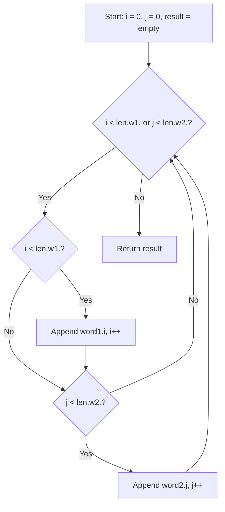

# 1768. Merge Strings Alternately

## Problem Statement

You are given two strings `word1` and `word2`. Merge the strings by adding letters in alternating order, starting with `word1`. If a string is longer than the other, append the additional letters onto the end of the merged string.

Return the merged string.

### Example 1:
```
Input: word1 = "abc", word2 = "pqr"
Output: "apbqcr"
Explanation: The merged string will be merged as so:
word1:  a   b   c
word2:    p   q   r
merged: a p b q c r
```

### Example 2:
```
Input: word1 = "ab", word2 = "pqrs"
Output: "apbqrs"
Explanation: Notice that as word2 is longer, "rs" is appended to the end.
word1:  a   b 
word2:    p   q   r   s
merged: a p b q   r   s
```

### Example 3:
```
Input: word1 = "abcd", word2 = "pq"
Output: "apbqcd"
Explanation: Notice that as word1 is longer, "cd" is appended to the end.
word1:  a   b   c   d
word2:    p   q 
merged: a p b q c   d
```

---

## Approach

We can use the **Two Pointers (Interleaving)** technique:

1. Maintain two indices: `i = 0` (for `word1`) and `j = 0` (for `word2`).
2. Run a loop while `i < word1.length() || j < word2.length()`.
3. If `i < word1.length()`, append `word1[i]` to `result` and increment `i`.
4. If `j < word2.length()`, append `word2[j]` to `result` and increment `j`.
5. Return the assembled `result` string.



---

## Code Implementation

```cpp
#include <string>

class Solution {
public:
    std::string mergeAlternately(std::string word1, std::string word2) {
        std::string result = "";
        int i = 0, j = 0;
        int n1 = word1.length(), n2 = word2.length();
        
        while (i < n1 || j < n2) {
            if (i < n1) result += word1[i++];
            if (j < n2) result += word2[j++];
        }
        
        return result;
    }
};
```

---

## Complexity Analysis

- **Time Complexity**: $O(m + n)$ — where $m$ and $n$ are the lengths of `word1` and `word2` respectively. Each character is appended once.

- **Space Complexity**: $O(1)$ — Beyond the space needed to hold the output string, only constant extra variables are used.

---
