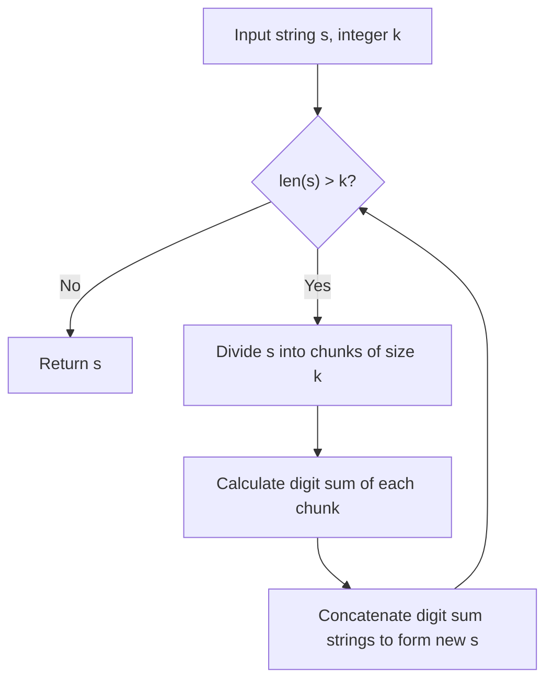

# 2243. Calculate Digit Sum of a String

## Problem Statement

You are given a string `s` consisting of digits and an integer `k`.

A round can be completed if the length of `s` is greater than `k`. In one round, do the following:
1. **Divide** `s` into consecutive groups of size `k` such that the first `k` characters are in the first group, the next `k` characters are in the second group, and so on. Note that the size of the last group can be smaller than `k`.
2. **Calculate** the sum of the digits for each group.
3. **Merge** consecutive new strings to produce a new string `s`.

Repeat this process until the string's length is less than or equal to `k`.

Return `s` after all rounds have been completed.

### Example 1:

```
Input: s = "11111222223", k = 3
Output: "135"
Explanation: 
- For the first round, we divide s into groups of size 3: "111", "112", "222", and "23".
  Then we calculate the digit sum of each group: 1 + 1 + 1 = 3, 1 + 1 + 2 = 4, 2 + 2 + 2 = 6, and 2 + 3 = 5.
  So, s becomes "3" + "4" + "6" + "5" = "3465" after the first round.
- For the second round, we divide s into groups of size 3: "346" and "5".
  Then we calculate the digit sum of each group: 3 + 4 + 6 = 13, 5 = 5.
  So, s becomes "13" + "5" = "135" after the second round.
- Now, s.length <= k, so we return "135".
```

### Example 2:

```
Input: s = "00000000", k = 3
Output: "000"
Explanation: 
- 1st round: "000", "000", "00" -> 0 + 0 + 0 = 0, 0 + 0 + 0 = 0, 0 + 0 = 0 -> "000".
- s.length <= k, so we return "000".
```

### Constraints:

- $1 \le s.\text{length} \le 100$
- $2 \le k \le 100$
- `s` consists of digits only.

---

## Approach

### 1. Direct Simulation
- The problem constraints are small ($n \le 100$, $k \ge 2$), making an iterative simulation both straightforward and optimal.
- We maintain a `while` loop that runs as long as $\text{len}(s) > k$.
- Within each iteration (round):
  1. Chunk $s$ into contiguous substrings of length $k$ (the last chunk may have length $< k$).
  2. For each chunk, sum the integer values of its characters: $\sum_{c \in \text{chunk}} (c - '0')$.
  3. Convert each computed integer sum to its string representation and concatenate them into `next_round`.
  4. Replace $s$ with `next_round`.
- Once $\text{len}(s) \le k$, terminate the loop and return $s$.



---

## Code Implementation

### C++

```cpp
#include <string>
#include <algorithm>

using namespace std;

class Solution {
public:
    string digitSum(string s, int k) {
        while (s.length() > static_cast<size_t>(k)) {
            string next_round = "";
            for (size_t i = 0; i < s.length(); i += k) {
                int group_sum = 0;
                size_t end = min(s.length(), i + k);
                for (size_t j = i; j < end; ++j) {
                    group_sum += (s[j] - '0');
                }
                next_round += to_string(group_sum);
            }
            s = move(next_round);
        }
        return s;
    }
};
```

### Python3

```python
class Solution:
    def digitSum(self, s: str, k: int) -> str:
        while len(s) > k:
            next_round = []
            for i in range(0, len(s), k):
                chunk = s[i:i + k]
                chunk_sum = sum(int(ch) for ch in chunk)
                next_round.append(str(chunk_sum))
            s = "".join(next_round)
        return s
```

---

## Complexity Analysis

- **Time Complexity**: $O(n)$ — where $n$ is the initial length of string `s`. Because $k \ge 2$, every chunk of $k$ digits is compressed into its sum, significantly shrinking the string length in each round. The total work across all rounds forms a converging geometric series bounded by $O(n)$.
- **Space Complexity**: $O(n)$ — Auxiliary memory required to construct intermediate round strings and store chunks.

---
