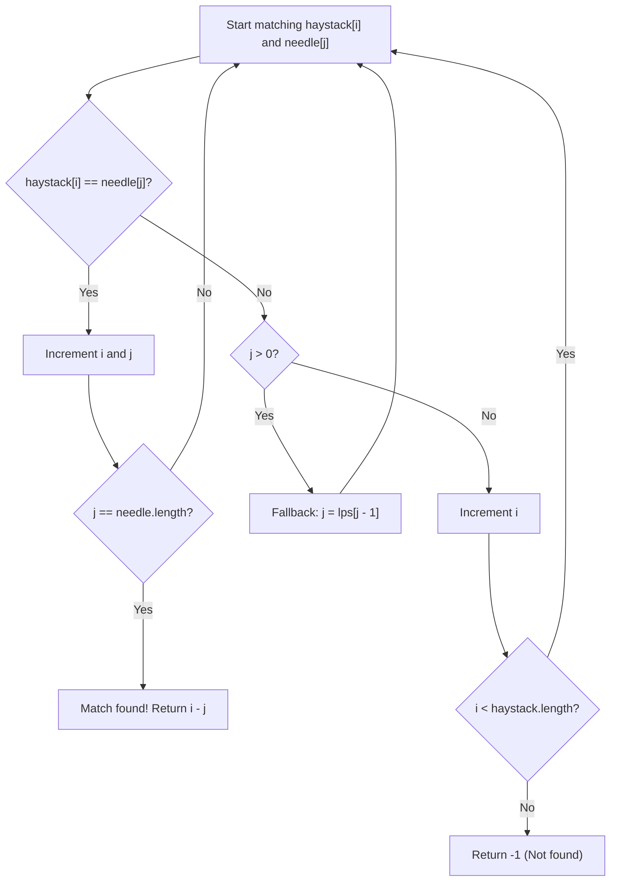

# 28. Find the Index of the First Occurrence in a String

## Problem Statement

Given two strings `needle` and `haystack`, return the index of the first occurrence of `needle` in `haystack`, or `-1` if `needle` is not part of `haystack`.

### Example 1:
```
Input: haystack = "sadbutsad", needle = "sad"
Output: 0
Explanation: "sad" occurs at index 0 and 6.
The first occurrence is at index 0, so we return 0.
```

### Example 2:
```
Input: haystack = "leetcode", needle = "leeto"
Output: -1
Explanation: "leeto" did not occur in "leetcode", so we return -1.
```

### Constraints:
- $1 \le \text{haystack.length}, \text{needle.length} \le 10^4$
- `haystack` and `needle` consist of only lowercase English characters.

---

## Approach

### Method 1: Sliding Window / Substring Matching
1. Let $n = \text{haystack.length}$ and $m = \text{needle.length}$.
2. If $m > n$, `needle` cannot be part of `haystack`, return `-1`.
3. Slide a window of length $m$ over `haystack` from index $i = 0$ to $n - m$:
   - Check if the substring of `haystack` starting at $i$ with length $m$ equals `needle`.
   - If a match is found, return $i$ immediately.
4. If no match is found after scanning all valid start positions, return `-1`.

### Method 2: Knuth-Morris-Pratt (KMP) Algorithm (Optimal)
1. **Precompute Longest Prefix-Suffix (LPS) Array:**
   - $\text{lps}[i]$ stores the length of the longest proper prefix of $\text{needle}[0 \dots i]$ that is also a suffix of $\text{needle}[0 \dots i]$.
   - This preprocessing takes $O(m)$ time and allows skipping redundant character comparisons when a mismatch occurs.
2. **Search Phase:**
   - Maintain two pointers: $i$ for `haystack` and $j$ for `needle`.
   - When characters match ($\text{haystack}[i] == \text{needle}[j]$), increment both $i$ and $j$.
   - When $j == m$, a full match is found at index $i - m$.
   - On a mismatch after $j > 0$ matches, reset $j = \text{lps}[j - 1]$ without rolling back pointer $i$.
   - If mismatch occurs with $j == 0$, simply increment $i$.



---

## Code Implementation

### C++ (KMP Algorithm & Sliding Window)

```cpp
class Solution {
public:
    int strStr(string haystack, string needle) {
        int n = haystack.size();
        int m = needle.size();
        if (m > n) return -1;

        // Step 1: Build LPS (Longest Prefix Suffix) array
        vector<int> lps(m, 0);
        int prevLPS = 0, i = 1;
        while (i < m) {
            if (needle[i] == needle[prevLPS]) {
                lps[i] = prevLPS + 1;
                prevLPS++;
                i++;
            } else if (prevLPS == 0) {
                lps[i] = 0;
                i++;
            } else {
                prevLPS = lps[prevLPS - 1];
            }
        }

        // Step 2: KMP Search
        int h = 0, nIdx = 0;
        while (h < n) {
            if (haystack[h] == needle[nIdx]) {
                h++;
                nIdx++;
            } else {
                if (nIdx == 0) {
                    h++;
                } else {
                    nIdx = lps[nIdx - 1];
                }
            }

            if (nIdx == m) {
                return h - m;
            }
        }

        return -1;
    }
};
```

### Python3

```python
class Solution:
    def strStr(self, haystack: str, needle: str) -> int:
        n, m = len(haystack), len(needle)
        if m > n:
            return -1

        # Build LPS array
        lps = [0] * m
        prev_lps, i = 0, 1
        while i < m:
            if needle[i] == needle[prev_lps]:
                prev_lps += 1
                lps[i] = prev_lps
                i += 1
            elif prev_lps == 0:
                lps[i] = 0
                i += 1
            else:
                prev_lps = lps[prev_lps - 1]

        # KMP Matching
        h, n_idx = 0, 0
        while h < n:
            if haystack[h] == needle[n_idx]:
                h += 1
                n_idx += 1
            else:
                if n_idx == 0:
                    h += 1
                else:
                    n_idx = lps[n_idx - 1]

            if n_idx == m:
                return h - m

        return -1
```

---

## Complexity Analysis

- **Time Complexity**:
  - **KMP Algorithm**: $O(n + m)$ — building the LPS array takes $O(m)$, and matching traverses `haystack` without backtracking $h$, taking $O(n)$.
  - **Sliding Window**: $O((n - m + 1) \cdot m)$ in worst case (e.g., `"aaaaab"` and `"aab"`).
- **Space Complexity**:
  - **KMP Algorithm**: $O(m)$ — storage for the `lps` array of size $m$.
  - **Sliding Window**: $O(1)$ — constant auxiliary memory if using direct substring views/pointers.

---
