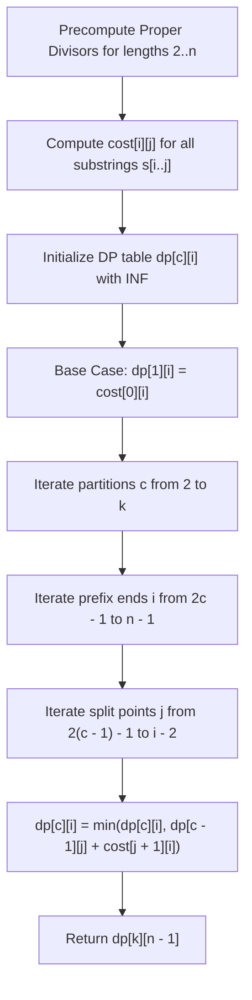

# 2911. Minimum Changes to Make K Semi-palindromes

## Problem Statement

Given a string `s` and an integer `k`, partition `s` into `k` **substrings** such that the letter changes needed to make each substring a **semi-palindrome** are minimized.

Return the **minimum** number of letter changes required.

A **semi-palindrome** is a string that can be divided into $d$ groups where $1 \le d < \text{length}$ is a **proper divisor** of the string's length such that:
- For each group $j$ ($0 \le j < d$), the characters at indices congruent to $j \pmod d$ form a **palindrome**.

A **substring** is a contiguous sequence of characters within a string.

---

### Example 1:

```
Input: s = "abcac", k = 2
Output: 1
Explanation:
We can divide s into substrings "ab" and "cac".
- "cac" is already a semi-palindrome with d = 1 (palindromic group "cac"). Changes needed = 0.
- "ab" can be made into a semi-palindrome with d = 1 by changing 'b' to 'a' to form "aa" (palindrome). Changes needed = 1.
Total changes = 0 + 1 = 1.
```

### Example 2:

```
Input: s = "abcdef", k = 2
Output: 2
Explanation:
We can divide s into substrings "abc" and "def".
- "abc" can be turned into "aba" with d = 1 (1 change).
- "def" can be turned into "ded" with d = 1 (1 change).
Total changes = 1 + 1 = 2.
```

### Example 3:

```
Input: s = "aabbaa", k = 3
Output: 0
Explanation:
We can divide s into substrings "aa", "bb", and "aa".
All three substrings are already semi-palindromes with d = 1.
Total changes = 0 + 0 + 0 = 0.
```

---

### Constraints:

- $2 \le s.\text{length} \le 200$
- $1 \le k \le \lfloor s.\text{length} / 2 \rfloor$
- `s` consists only of lowercase English letters.

---

## Approach

### 1. Semi-Palindrome Definition & Divisor Analysis
- For a substring of length $L = j - i + 1$:
  - A proper divisor $d$ satisfies $1 \le d < L$ and $L \pmod d = 0$.
  - Since $d < L$, any semi-palindrome must have length $L \ge 2$. (Strings of length 1 have no proper divisors).
  - This constraint is why $k \le \lfloor n / 2 \rfloor$: each of the $k$ parts must have length at least 2.
- For a chosen proper divisor $d$:
  - The substring is partitioned into $d$ interleaved groups of size $m = L / d$.
  - Group $r$ ($0 \le r < d$) consists of characters at 0-indexed positions within the substring:
    $$\text{group}_r = [r, r + d, r + 2d, \dots, r + (m - 1)d]$$
  - To make $\text{group}_r$ palindromic, compare characters symmetric about the center:
    $$\text{mismatches}(r) = \sum_{t=0}^{\lfloor m/2 \rfloor - 1} [\text{group}_r[t] \ne \text{group}_r[m - 1 - t]]$$
  - The total cost for a specific divisor $d$ is $\sum_{r=0}^{d-1} \text{mismatches}(r)$.
  - The minimum modification cost $\text{cost}[i][j]$ for substring $s[i \dots j]$ is the minimum over all proper divisors $d$ of $L$:
    $$\text{cost}[i][j] = \min_{d \mid L, 1 \le d < L} \left( \sum_{r=0}^{d-1} \sum_{t=0}^{\lfloor m/2 \rfloor - 1} [s[i + r + td] \ne s[i + r + (m - 1 - t)d]] \right)$$

### 2. Substring Cost Precomputation
- Precompute all proper divisors for each length $L \in [2, n]$.
- For each starting index $i$ and ending index $j$ ($j \ge i + 1$), compute $\text{cost}[i][j]$ across all valid proper divisors of $L = j - i + 1$.
- Because $n \le 200$, the number of pairs $(i, j)$ is $\approx \frac{200^2}{2} = 20,000$. For each pair, iterating over divisors and character pairs takes at most $O(L)$ operations. Precomputation completes in $\approx 2 \times 10^6$ operations.

### 3. Dynamic Programming for Partitioning
- Define $\text{dp}[c][i]$ as the minimum number of changes required to partition the prefix $s[0 \dots i]$ into $c$ semi-palindromes.
- **Base Case** ($c = 1$):
  $$\text{dp}[1][i] = \text{cost}[0][i] \quad \text{for } 1 \le i < n$$
- **Transitions** ($2 \le c \le k$):
  - The $c$-th semi-palindrome can end at index $i$, with the previous $c - 1$ semi-palindromes ending at index $j$.
  - Constraints on indices:
    - Prefix $s[0 \dots j]$ contains $c - 1$ parts of length $\ge 2$, so $j \ge 2(c - 1) - 1$.
    - Substring $s[j + 1 \dots i]$ has length $\ge 2$, so $j + 1 \le i - 1 \implies j \le i - 2$.
    - Current end index $i \ge 2c - 1$.
  - Transition formula:
    $$\text{dp}[c][i] = \min_{2(c-1)-1 \le j \le i-2} (\text{dp}[c - 1][j] + \text{cost}[j + 1][i])$$
- **Result**: $\text{dp}[k][n - 1]$.



---

## Code Implementation

### C++

```cpp
#include <string>
#include <vector>
#include <algorithm>

using namespace std;

class Solution {
public:
    int minimumChanges(string s, int k) {
        int n = s.size();

        // Precompute proper divisors for each length L in [2, n]
        vector<vector<int>> divisors(n + 1);
        for (int d = 1; d <= n; ++d) {
            for (int len = 2 * d; len <= n; len += d) {
                divisors[len].push_back(d);
            }
        }

        // Precompute cost[i][j]: min changes to turn s[i..j] into a semi-palindrome
        vector<vector<int>> cost(n, vector<int>(n, 0));
        for (int i = 0; i < n; ++i) {
            for (int j = i + 1; j < n; ++j) {
                int len = j - i + 1;
                int min_c = 1e9;
                for (int d : divisors[len]) {
                    int cur_c = 0;
                    int step = len / d;
                    for (int offset = 0; offset < d; ++offset) {
                        int left = 0;
                        int right = step - 1;
                        while (left < right) {
                            if (s[i + offset + left * d] != s[i + offset + right * d]) {
                                cur_c++;
                            }
                            left++;
                            right--;
                        }
                    }
                    min_c = min(min_c, cur_c);
                }
                cost[i][j] = min_c;
            }
        }

        // DP: dp[c][i] = min changes to partition s[0..i] into c semi-palindromes
        const int INF = 1e9;
        vector<vector<int>> dp(k + 1, vector<int>(n, INF));

        // Base case: c = 1 partition
        for (int i = 1; i < n; ++i) {
            dp[1][i] = cost[0][i];
        }

        // Transitions for c from 2 to k
        for (int c = 2; c <= k; ++c) {
            for (int i = 2 * c - 1; i < n; ++i) {
                for (int j = 2 * (c - 1) - 1; j <= i - 2; ++j) {
                    if (dp[c - 1][j] != INF) {
                        dp[c][i] = min(dp[c][i], dp[c - 1][j] + cost[j + 1][i]);
                    }
                }
            }
        }

        return dp[k][n - 1];
    }
};
```

### Python3

```python
class Solution:
    def minimumChanges(self, s: str, k: int) -> int:
        n = len(s)

        # Precompute proper divisors for each length L in [2, n]
        divisors = [[] for _ in range(n + 1)]
        for d in range(1, n + 1):
            for length in range(2 * d, n + 1, d):
                divisors[length].append(d)

        # Precompute cost[i][j]: min changes to turn s[i..j] into a semi-palindrome
        cost = [[0] * n for _ in range(n)]
        for i in range(n):
            for j in range(i + 1, n):
                length = j - i + 1
                min_c = float('inf')
                for d in divisors[length]:
                    cur_c = 0
                    step = length // d
                    for offset in range(d):
                        left = 0
                        right = step - 1
                        while left < right:
                            idx1 = i + offset + left * d
                            idx2 = i + offset + right * d
                            if s[idx1] != s[idx2]:
                                cur_c += 1
                            left += 1
                            right -= 1
                    min_c = min(min_c, cur_c)
                cost[i][j] = min_c

        # DP: dp[c][i] = min changes to partition s[0..i] into c semi-palindromes
        INF = float('inf')
        dp = [[INF] * n for _ in range(k + 1)]

        # Base case: c = 1 partition
        for i in range(1, n):
            dp[1][i] = cost[0][i]

        # DP transitions for c partitions
        for c in range(2, k + 1):
            for i in range(2 * c - 1, n):
                for j in range(2 * (c - 1) - 1, i - 1):
                    if dp[c - 1][j] != INF:
                        dp[c][i] = min(dp[c][i], dp[c - 1][j] + cost[j + 1][i])

        return dp[k][n - 1]
```

---

## Complexity Analysis

- **Time Complexity**:
  - **Divisor Precomputation**: $\sum_{d=1}^n \frac{n}{d} = O(n \log n)$.
  - **Substring Cost Precomputation**: There are $O(n^2)$ substrings. For a substring of length $L$, the number of proper divisors is $\sigma_0(L) \ll L$. Across all divisors $d$, character comparison takes $\sum_{d \mid L} \frac{L}{2} = O(L \cdot \sigma_0(L))$. For $n \le 200$, total checks across all pairs is $\approx 1.5 \times 10^6$ operations.
  - **Dynamic Programming**: $k$ partition states, each checking up to $n$ endpoints and $n$ split points, yielding $O(k \cdot n^2)$ transitions. With $k \le 100$ and $n \le 200$, this requires $\approx 4 \times 10^5$ operations.
  - **Overall Time Complexity**: $O(n^3 + k \cdot n^2)$, well within the 1-second limit for $n \le 200$.

- **Space Complexity**:
  - `divisors` list: $O(n \log n)$.
  - `cost` table: $O(n^2)$ integers.
  - `dp` table: $O(k \cdot n)$ integers.
  - **Overall Space Complexity**: $O(n^2)$, consuming less than $2 \text{ MB}$.

---
