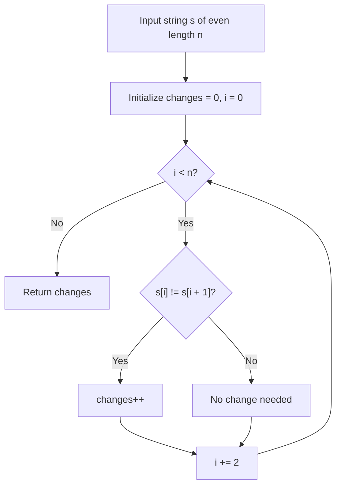

# 2914. Minimum Number of Changes to Make Binary String Beautiful

## Problem Statement

You are given a **0-indexed** binary string `s` having an **even length**.

A string is **beautiful** if it's possible to partition it into one or more substrings such that:
1. Each substring has an **even length**.
2. Each substring contains **only** `1`'s or **only** `0`'s.

You can change any character in `s` to `0` or `1`.

Return the **minimum** number of changes required to make the string `s` beautiful.

---

### Example 1:

```
Input: s = "1001"
Output: 2
Explanation:
We change s[1] to '1' and s[3] to '0' to get string "1100".
It can be seen that the string "1100" is beautiful because we can partition it into "11" and "00".
Each substring has an even length (2) and consists of only identical characters.
It can be proven that 2 is the minimum number of changes needed.
```

### Example 2:

```
Input: s = "10"
Output: 1
Explanation:
We change s[1] to '1' to get string "11".
The string "11" is beautiful because we can partition it into "11".
It can be proven that 1 is the minimum number of changes needed.
```

### Example 3:

```
Input: s = "0000"
Output: 0
Explanation:
We don't need to make any changes as the string "0000" is already beautiful (can be partitioned into "0000" or "00" and "00").
```

---

### Constraints:

- $2 \le s.\text{length} \le 10^5$
- $s.\text{length}$ is even.
- $s[i]$ is either `'0'` or `'1'`.

---

## Approach

### 1. Independent Pair Decomposition
- The problem requires partitioning $s$ into contiguous substrings such that each part has an even length and consists of all `'0'`s or all `'1'`s.
- Any valid even-length uniform substring of length $2m$ (e.g., `"0000"`) can always be decomposed into $m$ independent blocks of length 2 (`"00"`, `"00"`).
- Consequently, the smallest atomic valid block has length **2**.
- If we ensure that every adjacent pair of characters $(s[2i], s[2i + 1])$ is identical for all $0 \le i < n / 2$:
  - Whenever adjacent pairs of length 2 happen to share the same character (e.g. `"00"` followed by `"00"`), they merge into a longer valid block (`"0000"`).
  - Whenever they differ (e.g. `"00"` followed by `"11"`), they remain separate valid blocks of length 2.
- Therefore, a string is beautiful if and only if every pair $(s[2i], s[2i + 1])$ consists of matching characters.

### 2. Greedy Counting
- Iterate through $s$ with step size 2:
  - If $s[2i] \ne s[2i + 1]$, exactly **1 change** is required to make the pair uniform (either change $s[2i]$ to $s[2i + 1]$ or vice versa).
  - If $s[2i] == s[2i + 1]$, **0 changes** are needed.
- Summing $[s[2i] \ne s[2i + 1]]$ over all pairs gives the minimum total changes.



---

## Code Implementation

### C++

```cpp
#include <string>

using namespace std;

class Solution {
public:
    int minChanges(string s) {
        int changes = 0;
        int n = s.length();

        for (int i = 0; i < n; i += 2) {
            if (s[i] != s[i + 1]) {
                changes++;
            }
        }

        return changes;
    }
};
```

### Python3

```python
class Solution:
    def minChanges(self, s: str) -> int:
        changes = 0
        n = len(s)

        for i in range(0, n, 2):
            if s[i] != s[i + 1]:
                changes += 1

        return changes
```

---

## Complexity Analysis

- **Time Complexity**: $O(n)$ — We perform a single linear scan through the string, examining $n / 2$ pairs in $O(1)$ time per pair.
- **Space Complexity**: $O(1)$ — Only a single integer counter `changes` is maintained; no auxiliary structures or allocations are used.

---
