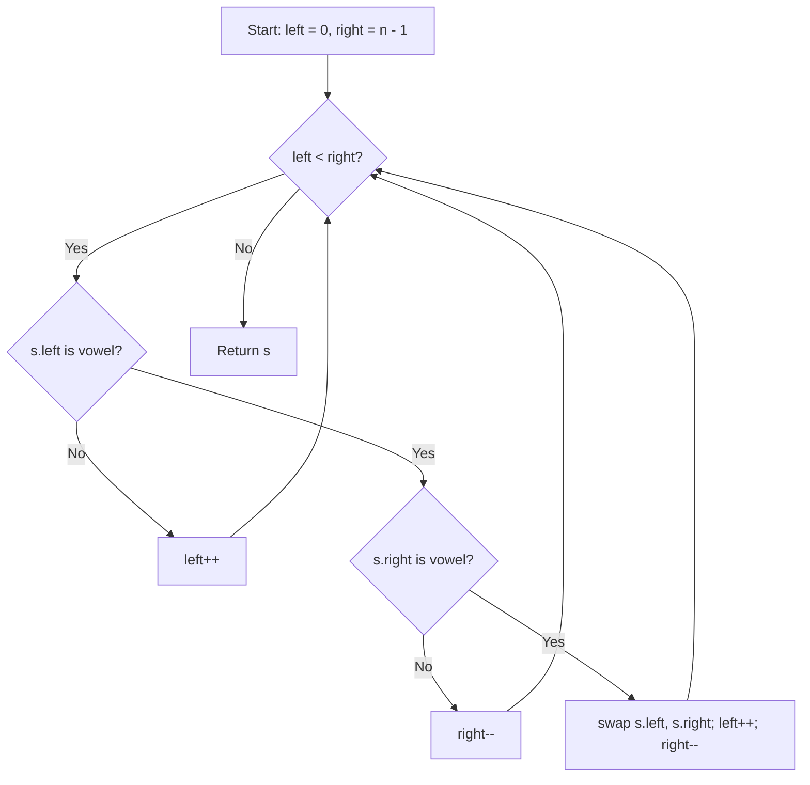

# 345. Reverse Vowels of a String

## Problem Statement

Given a string `s`, reverse only all the vowels in the string and return it.

The vowels are `'a'`, `'e'`, `'i'`, `'o'`, and `'u'`, and they can appear in both lower and upper cases, more than once.

### Example 1:
```
Input: s = "IceCreAm"
Output: "AceCreIm"
Explanation: The vowels in s are ['I', 'e', 'e', 'A']. On reversing the vowels, s becomes "AceCreIm".
```

### Example 2:
```
Input: s = "leetcode"
Output: "leotcede"
```

### Constraints:
- `1 <= s.length <= 3 * 10^5`
- `s` consist of printable ASCII characters.

---

## Approach

We can use the **Two Pointers** technique:

1. Maintain two pointers: `left` starting at index `0` and `right` starting at index `s.length() - 1`.
2. Define a helper function `isVowel` that returns `true` if a character is one of `a, e, i, o, u` (case-insensitive).
3. Increment `left` until it points to a vowel.
4. Decrement `right` until it points to a vowel.
5. If `left < right`, swap `s[left]` and `s[right]`, then advance `left++` and decrement `right--`.
6. Repeat until `left >= right`, then return `s`.



---

## Code Implementation

```cpp
#include <string>
#include <algorithm>

class Solution {
private:
    bool isVowel(char c) {
        c = std::tolower(c);
        return c == 'a' || c == 'e' || c == 'i' || c == 'o' || c == 'u';
    }

public:
    std::string reverseVowels(std::string s) {
        int left = 0;
        int right = s.length() - 1;
        
        while (left < right) {
            while (left < right && !isVowel(s[left])) {
                left++;
            }
            while (left < right && !isVowel(s[right])) {
                right--;
            }
            if (left < right) {
                std::swap(s[left], s[right]);
                left++;
                right--;
            }
        }
        
        return s;
    }
};
```

---

## Complexity Analysis

- **Time Complexity**: $O(n)$ — Each character in the string is visited at most once by `left` and `right`. Checking vowel status is $O(1)$.

- **Space Complexity**: $O(1)$ — Characters are swapped in-place with no additional data structures.

---
