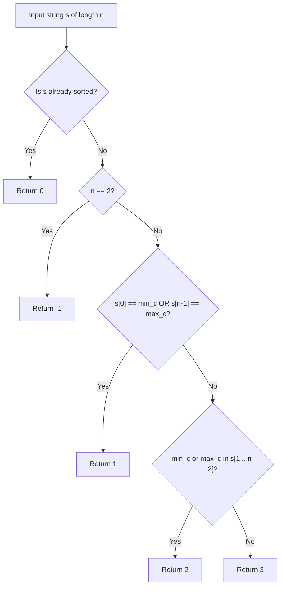

# 3863. Minimum Operations to Sort a String

## Problem Statement

You are given a string `s` consisting of lowercase English letters.

In one operation, you can select any **proper substring** of `s` (a substring that is not the entire string) and sort it in non-descending alphabetical order.

Return the **minimum number of operations** required to make `s` sorted in non-descending order. If it is impossible to sort the string, return `-1`.

---

### Example 1:
```
Input: s = "dog"
Output: 1
Explanation:
- Choose the proper substring "og" at indices [1, 2] and sort it to "go".
- The string becomes "dgo", which is sorted in non-descending order.
```

### Example 2:
```
Input: s = "card"
Output: 2
Explanation:
- Operation 1: Choose the proper substring "car" at indices [0, 2] and sort it to "acr". The string becomes "acrd".
- Operation 2: Choose the proper substring "rd" at indices [2, 3] and sort it to "dr". The string becomes "acdr", which is sorted.
```

### Example 3:
```
Input: s = "gf"
Output: -1
Explanation:
The only proper substrings of "gf" are "g" and "f" of length 1, sorting which does not change the string. Since we cannot choose the entire string of length 2, it is impossible to sort. Return -1.
```

---

### Constraints:
- `1 <= s.length <= 10^5`
- `s` consists only of lowercase English letters.

---

## Approach

### 1. Classification via Greedy Case Analysis
Because each operation can sort *any* proper substring (up to length $n - 1$), the problem reduces to examining the boundary elements and the positions of the global minimum and maximum characters:

1. **Case 0: Already Sorted (0 Operations)**
   - If `s` is already in non-descending order, `0` operations are required.

2. **Case -1: Impossible Condition (-1 Operations)**
   - If $n = 2$ and `s` is unsorted (e.g., `"ba"`), any proper substring has length 1. Sorting a single character changes nothing, and sorting the full string is prohibited. Thus, return `-1`.

3. **Case 1: Boundary Aligned (1 Operation)**
   - Let `min_c` be the smallest character in `s` and `max_c` be the largest character.
   - If `s[0] == min_c`, sorting the proper suffix $s[1 \dots n-1]$ immediately places all remaining elements in sorted order.
   - If `s[n - 1] == max_c`, sorting the proper prefix $s[0 \dots n-2]$ immediately sorts the entire string.
   - Either condition allows sorting in `1` operation.

4. **Case 2: Internal Extremum Available (2 Operations)**
   - If there is an occurrence of `min_c` strictly inside the interior $s[1 \dots n-2]$:
     - Operation 1: Sort a prefix containing that `min_c` to bring `min_c` to index `0`.
     - Operation 2: Sort the suffix $s[1 \dots n-1]$ to complete sorting.
   - Similarly, if `max_c` appears anywhere in $s[1 \dots n-2]$, sort a suffix containing it to move `max_c` to index $n-1$, then sort prefix $s[0 \dots n-2]$.
   - This takes `2` operations.

5. **Case 3: Inverted Boundaries (3 Operations)**
   - If the global maximum occurs exclusively at the start (`s[0] == max_c`) and the global minimum occurs exclusively at the end (`s[n - 1] == min_c`), neither proper prefix nor proper suffix can directly relocate both extremes to opposite ends in fewer than 3 operations:
     - Operation 1: Sort an interior segment or prefix to shuffle intermediate elements.
     - Operation 2: Relocate the minimum to index 0 or maximum to index $n-1$.
     - Operation 3: Sort the remaining suffix/prefix.
   - This worst-case scenario takes strictly `3` operations.



---

## Code Implementation

```cpp
#include <string>
#include <algorithm>

class Solution {
public:
    int minOperations(std::string s) {
        int n = s.length();

        // Case 0: Already sorted
        bool isSorted = true;
        for (int i = 1; i < n; ++i) {
            if (s[i] < s[i - 1]) {
                isSorted = false;
                break;
            }
        }
        if (isSorted) return 0;

        // Case -1: Cannot sort full string when length is 2
        if (n == 2) return -1;

        char min_c = s[0];
        char max_c = s[0];
        char mid_min = 'z';
        char mid_max = 'a';

        for (int i = 0; i < n; ++i) {
            if (s[i] < min_c) min_c = s[i];
            if (s[i] > max_c) max_c = s[i];

            if (i > 0 && i < n - 1) {
                if (s[i] < mid_min) mid_min = s[i];
                if (s[i] > mid_max) mid_max = s[i];
            }
        }

        // Case 1: Minimum at start or maximum at end
        if (s[0] == min_c || s[n - 1] == max_c) {
            return 1;
        }

        // Case 2: Minimum or maximum present in interior
        if (mid_min == min_c || mid_max == max_c) {
            return 2;
        }

        // Case 3: Strictly 3 operations required
        return 3;
    }
};
```

---

## Complexity Analysis

- **Time Complexity**: $O(n)$ — A single linear scan checks whether the string is sorted, and another linear pass finds the boundary and interior character extrema.
- **Space Complexity**: $O(1)$ — Auxiliary space is $O(1)$ as only primitive characters and boolean flags are maintained.

---
